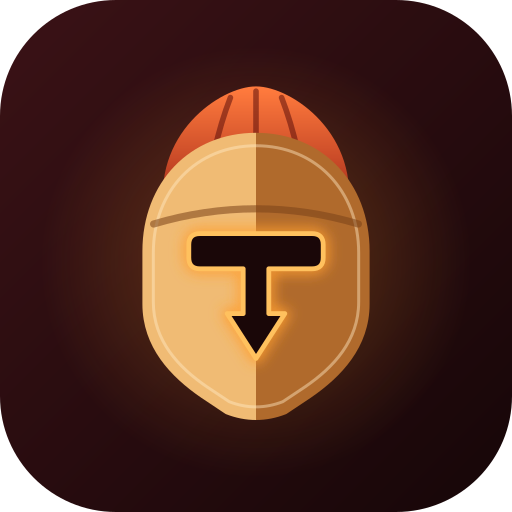

<div align="center">
  
  <h1>Talos: Pengunduh Video dan Audio</h1>
  <p><b>Unduh video dan audio dari internet, dengan playlist, subtitle,<br/>
  metadata tertanam, dan sebuah nama yang layak dijaga.</b></p>

  <a href="https://github.com/nekonaru/talos/releases"></a>
  <a href="https://github.com/nekonaru/talos/actions/workflows/ci.yml"></a>
  
  
  
  
</div>

<br />

[English](README.md) | **Bahasa Indonesia**

> [!NOTE]
> Di Android, file yang diunduh disimpan di penyimpanan pribadi aplikasi, dan kamu membukanya dengan aksi share. Di desktop, file masuk ke folder downloads secara bawaan.

---

## Daftar Isi

- [Tentang](#tentang)
- [Fitur](#fitur)
- [Kebutuhan](#kebutuhan)
- [Instalasi](#instalasi)
- [Penggunaan](#penggunaan)
- [Bahasa Tampilan](#bahasa-tampilan)
- [Sumber Data](#sumber-data)
- [Struktur Proyek](#struktur-proyek)
- [Pengembangan](#pengembangan)
- [Pengujian](#pengujian)
- [Continuous Integration](#continuous-integration)
- [Tanya Jawab](#tanya-jawab)
- [Penulis](#penulis)
- [Penyangkalan](#penyangkalan)
- [Lisensi](#lisensi)

---

## Tentang

**Talos** adalah pengunduh video dan audio gratis dan sumber terbuka untuk Android, iOS, Windows, macOS dan Linux. Tunjukkan link dari situs yang didukung, pilih format, dan Talos mengambil serta menyimpan file-nya secara lokal. Mesin pengunduhnya adalah yt-dlp, berjalan in-process di Android lewat Chaquopy dan sebagai binary terkelola atau bawaan sistem di desktop.

> _"Sentinel perunggu untuk video dan lagu yang ingin kamu simpan."_

---

## Fitur

### Unduhan

| Fitur | Deskripsi |
|---------|-------------|
| **Video dan audio** | Unduh dari ribuan situs yang didukung yt-dlp, sebagai video atau audio |
| **Pemilihan format** | Video sampai 2160p, atau audio sebagai MP3, M4A, Opus, FLAC, atau format asli |
| **Kontrol lanjutan per unduhan** | Timpa kecepatan, proxy, dan header HTTP untuk satu unduhan |
| **Tampilan progres** | Persen, kecepatan, ETA, dan posisi playlist, dengan batal dan coba lagi |
| **Detail tugas** | Salin URL tugas dan lihat log di tahap apa pun, termasuk saat masih berjalan |
| **Antrean berurutan** | Satu unduhan pada satu waktu, agar situs tidak dihajar request paralel |
| **Retry dan mandek** | Backoff retry linier atau eksponensial, plus pengawas untuk unduhan yang berhenti berprogres |
| **Aturan folder** | Arahkan unduhan ke folder otomatis berdasarkan domain situs |
| **Jendela unduhan** | Batasi unduhan baru pada rentang jam tertentu, termasuk rentang lintas malam |
| **Antrean bertahan** | Unduhan tertunda tetap ada setelah aplikasi ditutup dan lanjut dengan pengaturan aslinya |
| **Batal dan coba lagi** | Batalkan tugas mana pun, coba lagi yang gagal atau dibatalkan dengan opsi sama |
| **Jeda dan bersihkan antrean** | Jeda unduhan baru tanpa menghentikan yang berjalan, atau batalkan semua yang masih tertunda |
| **Alasan menunggu** | Tab Aktif menjelaskan mengapa unduhan tertunda menunggu, misalnya WiFi, baterai, atau jendela unduhan |
| **Coba ulang otomatis** | Opsional mengulang kegagalan sementara otomatis dengan jeda singkat |

### Playlist

| Fitur | Deskripsi |
|---------|-------------|
| **Dukungan playlist penuh** | Ambil link playlist, lihat semua entri beserta durasinya, pilih semua atau sebagian |
| **Progres per item** | Lihat item playlist mana yang sedang diunduh dan berapa yang tersisa |
| **Filter playlist** | Pilih entri otomatis berdasarkan rentang durasi dan teks judul |

### Output File

| Fitur | Deskripsi |
|---------|-------------|
| **Penyematan metadata** | Sematkan judul, artis, sampul album dan metadata lain ke file audio dan video |
| **Thumbnail audio** | Sematkan sampul ke file audio (desktop dengan FFmpeg) |
| **Penyematan subtitle** | Sematkan subtitle ke file video, dengan bahasa yang bisa dipilih |
| **Template nama file** | Atur nama output dengan output template yt-dlp |

### Jaringan dan Filter

| Fitur | Deskripsi |
|---------|-------------|
| **Dukungan proxy** | Lewatkan unduhan lewat proxy HTTP atau SOCKS |
| **Hanya WiFi** | Di Android, antrean unduhan dijeda sampai koneksi WiFi aktif tersedia |
| **Hemat baterai** | Di Android, tahan unduhan baru saat baterai rendah dan perangkat tidak diisi |
| **Hanya saat mengisi** | Di Android, tunggu perangkat dicolok sebelum memulai unduhan tertunda |
| **Bagikan banyak tautan** | Bagikan beberapa URL dari aplikasi lain dan tangani sebagai satu batch |
| **Bantuan offline** | FAQ bawaan untuk pertanyaan umum tentang penyimpanan, penantian, cookie, dan cadangan |
| **Batas kecepatan** | Batasi kecepatan unduh, misal 5M atau 512K |
| **Fragment konkuren** | Percepat unduhan terfragmentasi dengan fragment paralel |
| **aria2c** | Gunakan aria2c sebagai external downloader di desktop bila terpasang |
| **SponsorBlock** | Hapus segmen sponsor, self-promo dan lainnya dari video per kategori |
| **File cookies** | Unduh dari situs yang butuh login dengan file cookies.txt |
| **Header kustom** | Kirim header HTTP tambahan, satu per baris, untuk situs yang membutuhkan Referer tertentu |

### Android

| Fitur | Deskripsi |
|---------|-------------|
| **Mesin tertanam** | yt-dlp berjalan in-process lewat Chaquopy, tanpa tool eksternal |
| **Foreground service** | Unduhan tetap berjalan saat aplikasi di latar belakang |
| **Share ke Talos** | Share link dari aplikasi mana pun langsung ke Talos |
| **Penyimpanan pribadi** | File tetap di dalam aplikasi; bagikan ke file manager atau aplikasi lain |

### Desktop

| Fitur | Deskripsi |
|---------|-------------|
| **Mesin terkelola** | yt-dlp diunduh sekali ke dalam aplikasi dan diperbarui otomatis |
| **Mesin sistem** | Atau gunakan yt-dlp dari PATH bila sudah terpasang |
| **Deteksi FFmpeg** | Otomatis menemukan FFmpeg di PATH, atau atur path kustom |
| **Update otomatis** | Cek dan perbarui yt-dlp terkelola dari Pengaturan |

### Tampilan dan Bahasa

| Fitur | Deskripsi |
|---------|-------------|
| **Desain gelap hangat** | Tema gelap hangat dengan aksen perunggu, plus mode terang dan mengikuti sistem |
| **Token desain bersama** | Spacing, radius, warna status semantik, dan animasi yang mengikuti reduced motion |
| **Penyiapan cepat** | Daftar kecil yang bisa ditutup untuk izin, kesiapan engine, dan unduhan pertama |
| **Folder penyimpanan** | Wawasan mengelompokkan unduhan selesai per folder beserta jumlah dan ukuran |
| **Jaga penyimpanan** | Tahan unduhan baru saat ruang kosong di bawah ambang pilihan |
| **Chip status** | Beranda menampilkan WiFi, pengisian daya, dan baterai rendah di Android |
| **Kepadatan adaptif** | Pilih kartu ringkas atau nyaman, dengan getar opsional |
| **Warna aksen** | Lima warna aksen: bronze, laurel, aegean, oxblood, marble |
| **Antarmuka dwibahasa** | English (bawaan) dan Bahasa Indonesia |

### Lainnya

| Fitur | Deskripsi |
|---------|-------------|
| **Perintah kustom** | Jalankan yt-dlp dengan template argumen buatanmu sendiri, kelola di dalam aplikasi |
| **Riwayat** | Unduhan selesai dengan pencarian, urutan, filter jenis, favorit, dan hapus banyak, dengan path file, ukuran, dan tanggal |
| **Retensi riwayat** | Opsional menghapus baris riwayat lama saat aplikasi dibuka tanpa menghapus file di penyimpanan |
| **Bersih file sementara** | Hapus sisa unduhan parsial dan file tmp agar penyimpanan tetap ringan |
| **Lisensi runtime** | Daftar eksplisit lisensi engine dan komponen native yang dipakai Talos |
| **Cadangkan dan pulihkan** | Ekspor pengaturan, riwayat, tautan tersimpan, preset, perintah, dan antrean tertunda sebagai JSON portabel, lalu pulihkan di perangkat yang sama atau yang baru |
| **Ekspor CSV** | Ekspor riwayat unduhan selesai sebagai file CSV yang ramah spreadsheet |
| **Aksi file** | Ubah nama atau pindahkan file selesai, dan kelola file subtitle dari riwayat |
| **Geser hapus** | Geser entri selesai untuk menghapus baris riwayatnya |
| **Detail playlist** | Lihat entri playlist dalam bottom sheet berisi nomor, judul, dan durasi |
| **Pintasan aplikasi** | Tahan ikon Android untuk Cari tautan, Unduhan, dan Jeda antrean |
| **Pencarian terpadu** | Cari tautan tersimpan dan unduhan terbaru dari Beranda |
| **Grafik kecepatan** | Sparkline kecepatan langsung pada kartu tugas yang berjalan |
| **Diagnostik** | Layar status engine dan antrean hanya-baca |
| **Impor riwayat CSV** | Pulihkan baris riwayat dari CSV yang pernah diekspor |
| **Ukuran teks** | Pilih skala teks minimum terpisah dari pengaturan sistem |
| **Bagikan banyak** | Bagikan beberapa file selesai sekaligus dari mode pilih |
| **Cari duplikat** | Hapus baris riwayat duplikat yang lebih lama tanpa menghapus file |
| **Ubah tautan tersimpan** | Salin, ubah, atau buka tautan tersimpan langsung dari daftar |
| **Tag tautan tersimpan** | Tambahkan tag pada tautan tersimpan dan filter daftar berdasarkan tag |
| **Mulai terjadwal** | Atur tanggal dan jam untuk satu unduhan dimulai |
| **Impor/ekspor antrean** | Salin atau pulihkan antrean tertunda sebagai JSON terpisah |
| **Simpan semua tautan** | Tambahkan semua URL yang terdeteksi dari teks tempelan sekaligus |
| **Mode privat** | Lewati riwayat sama sekali bila diinginkan |
| **Tinjau izin** | Lihat status izin notifikasi dan penyimpanan serta buka pengaturan sistem dari aplikasi |

---

## Kebutuhan

| Dependensi | Versi Minimum | Catatan |
|------------|-----------------|-------|
| **Flutter** | 3.47 (Dart 3.13) | Diperlukan hanya untuk build dari source |
| **JDK** | 17 | Diperlukan hanya untuk build dari source |
| **Android SDK** | API 24 | Diperlukan hanya untuk build dari source |
| **Perangkat atau emulator Android** | Android 7.0 (API 24) | Diperlukan untuk menjalankan di Android |
| **FFmpeg** | Build terbaru | Desktop saja, diperlukan untuk penyematan metadata, thumbnail dan subtitle |
| **aria2c** | Build terbaru | Desktop saja, external downloader opsional |

> [!TIP]
> Kalau kamu hanya ingin memakai aplikasinya, kamu tidak perlu Flutter, JDK atau Android SDK. Unduh APK dari halaman [Releases](https://github.com/nekonaru/talos/releases) saja.

### Belum pernah pakai terminal? Mulai dari sini

<details>
<summary><b>Cara membuka terminal di Windows</b></summary>

1. Tekan tombol **Windows**, ketik `PowerShell`, lalu tekan **Enter**
2. Jendela biru terbuka. Di situlah kamu mengetik perintah
3. Setiap perintah `flutter ...` atau `git ...` di panduan ini diketik di jendela itu, diikuti **Enter**

</details>

---

## Instalasi

### Opsi A: Unduh rilis siap pakai (paling mudah)

1. Buka halaman [Releases](https://github.com/nekonaru/talos/releases)
2. Unduh file untuk platformmu:
   - Android: `app-release.apk` (universal, untuk perangkat Android 64-bit)
   - Windows: `Talos-v0.52.0-windows-x64.zip`
   - Linux: `Talos-v0.52.0-linux-x64.tar.gz`
3. Khusus Android: buka APK, izinkan instalasi dari sumber tidak dikenal bila ditanya, berikan izin notifikasi

> [!NOTE]
> Mesin Android membundel Python 3.14 runtime, yang membutuhkan perangkat Android 64-bit ARM64 dan Android 7.0 atau lebih baru. Build macOS belum diterbitkan; build dari source (Opsi B).

> [!IMPORTANT]
> Izin notifikasi diperlukan untuk foreground download service di Android 13 ke atas. Tanpa itu, unduhan tetap berjalan tapi sistem menyembunyikan notifikasi unduhan.

#### Jika Android berkata "paket tampaknya tidak valid"

Setiap APK rilis dibangun oleh CI, ditandatangani dengan kunci Talos, diverifikasi dengan `apksigner`, dan diterbitkan dengan checksum SHA-256. Jika instalasi gagal di ponsel, hampir selalu salah satu dari ini penyebabnya:

1. **File salah.** Satu-satunya aset Android di rilis Talos adalah `app-release.apk` (sekitar 66 MB). APK lama atau bernama lain di folder Download bukan dari proyek ini.
2. **Download tidak lengkap.** Unduh ulang dengan koneksi stabil. Bandingkan SHA-256 file di ponsel dengan checksum di catatan rilis jika installer terus menolak.
3. **Perangkat 32-bit.** Talos membutuhkan perangkat 64-bit ARM64. Cek Pengaturan > Tentang ponsel; jika prosesornya 32-bit, APK tidak bisa dipasang.
4. **Aplikasi lama bentrok.** Jika ada build Talos dari sumber lain yang terpasang, hapus dulu, lalu pasang APK resmi. Build dengan kunci tanda tangan berbeda tidak bisa dijadikan pembaruan.

Talos tidak ada di Play Store, jadi Play Protect mungkin memberi peringatan sumber tidak dikenal. Ini wajar untuk instalasi APK langsung.

### Opsi B: Build dari source (untuk pengembangan / membaca atau mengubah kode)

#### 1. Ambil kode proyek

<details>
<summary><b>Saya punya Git</b></summary>

```bash
git clone https://github.com/nekonaru/talos.git
cd talos
```

</details>

<details>
<summary><b>Saya tidak punya Git</b></summary>

1. Buka halaman repositori di GitHub
2. Klik tombol hijau **`Code`**, pilih **`Download ZIP`**
3. Ekstrak ZIP ke folder pilihanmu
4. Di terminal, masuk ke folder hasil ekstrak, misalnya:

```bash
cd Downloads/talos-main
```

</details>

#### 2. Pasang dependensi dan verifikasi

```bash
flutter pub get
flutter gen-l10n
flutter analyze
```

> [!IMPORTANT]
> `flutter analyze` harus melaporkan **No issues found**.

#### 3. Build

```bash
# Android
flutter build apk --release

# Windows
flutter build windows --release

# Linux
flutter build linux --release

# macOS
flutter build macos --release
```

---

## Penggunaan

### Peluncuran pertama

1. Buka aplikasi. Tab Beranda meminta sebuah link
2. Tempel link video atau playlist dan tekan **Ambil**
3. Di layar konfigurasi, pilih video atau audio, pilih kualitas, lalu tekan **Unduh**
4. Pantau progres di tab **Unduhan**

> [!NOTE]
> Talos mengunduh file. Ia tidak melakukan streaming. Penggunaan yang sah adalah tanggung jawabmu.

### Pemakaian sehari-hari

- Pantau progres di tab **Unduhan**, batalkan atau coba lagi tugas di sana
- Jelajahi unduhan selesai di tab **Unduhan**, bagian Selesai
- Buka file lewat menu konteks: **Buka**, **Lihat di folder**, **Bagikan**, **Hapus dari daftar**, atau **Hapus file**
- Kelola unduhan dan opsi di **Pengaturan**
- Jalankan perintah yt-dlp buatanmu dari **Pengaturan > Perintah kustom**

---

## Bahasa Tampilan

Antarmuka aplikasi tersedia dalam **English** (bawaan) dan **Bahasa Indonesia**.

1. Buka **Pengaturan**
2. Gulir ke bagian tampilan
3. Bahasa antarmuka mengikuti bahasa sistem; ubah bahasa sistem untuk berganti

---

## Sumber Data

Talos hanya online untuk mengambil media yang kamu minta dan untuk mengirim request anonim bila kamu mengaturnya. Sumber yang dipakai:

| Tujuan | Sumber |
|---------|--------|
| Dukungan situs dan format | Situs yang didukung yt-dlp |
| Segmen SponsorBlock | SponsorBlock API, bila kamu mengaktifkannya di Pengaturan |
| Metadata dan thumbnail | Situs yang sedang kamu unduh |
| Cookies | File cookies.txt milikmu sendiri, bila diatur |

> [!NOTE]
> Talos tidak mengunggah unduhan atau data kamu ke mana pun. Unduhan berjalan langsung dari situs sumber ke perangkatmu.

---

## Struktur Proyek

```
talos/
├── lib/
│   ├── main.dart                 # titik masuk, membuat download manager
│   ├── app.dart                  # MaterialApp, tema, lokal
│   ├── app_scope.dart            # InheritedNotifier untuk state bersama
│   ├── core/                     # engine, store, antrean, layanan
│   │   ├── engine/               # interface engine, desktop dan Android (Chaquopy)
│   │   ├── download_manager.dart # antrean berurutan dengan batal/coba lagi
│   │   ├── settings_store.dart   # pengaturan disimpan sebagai JSON
│   │   ├── history_store.dart    # catatan unduhan selesai
│   │   ├── command_template_store.dart
│   │   └── theme.dart            # palet, warna aksen, tipografi
│   ├── screens/                  # home, configure, downloads, settings, commands, about
│   ├── l10n/                     # app_en.arb (English), app_id.arb (Bahasa Indonesia)
│   └── gen/                      # lokalisasi hasil generate (jangan diedit manual)
├── android/                      # build Android (Chaquopy, foreground service)
├── ios/, windows/, macos/, linux/# platform lain (Windows butuh Visual Studio)
├── assets/                       # master logo
├── test/                         # unit dan widget test
├── l10n.yaml                     # konfigurasi lokalisasi
├── BRAND.md                      # panduan merek
├── LICENSE                       # MIT License
├── README.md                     # dokumentasi (English)
└── README.id.md                  # dokumentasi (Bahasa Indonesia)
```

---

## Pengembangan

### Menambah string baru yang terlihat pengguna

1. Tambahkan key ke `lib/l10n/app_en.arb` (English) dan `lib/l10n/app_id.arb` (Bahasa Indonesia)
2. Jalankan `flutter gen-l10n`
3. Pakai lewat `AppLocalizations.of(context)!.namaKey`

> [!WARNING]
> File di dalam `lib/gen/` adalah hasil generate. Jangan diedit manual. Ubah file `.arb` lalu jalankan `flutter gen-l10n`.

### Menambah layar baru

1. Buat layarnya di `lib/screens/`
2. Tambahkan ke `lib/screens/shell.dart` bila masuk navigasi
3. Tambahkan string yang diperlukan ke kedua file `.arb` dan jalankan `flutter gen-l10n`

---

## Pengujian

Verifikasi sebelum setiap push, semuanya harus bersih:

```bash
flutter gen-l10n
flutter analyze
flutter test
```

| Pemeriksaan | Syarat |
|-------|-------------|
| `flutter gen-l10n` | Harus berjalan tanpa error |
| `flutter analyze` | Harus melaporkan **No issues found** (nol error, nol warning) |
| `flutter test` | Harus lolos seluruh suite (unit dan widget test) |

Lint ditegakkan lewat `analysis_options.yaml` (flutter_lints).

---

## Continuous Integration

| Workflow | Fungsi |
|----------|---------|
| `ci.yml` | Analyze, test dan build di setiap push dan pull request |

---

## Tanya Jawab

<details>
<summary><b>Unduhan macet di 0%?</b></summary>

Coba kualitas yang lebih kecil atau lebih umum dulu. Beberapa situs membatasi atau memblokir request tanpa cookies. Aktifkan file cookies.txt di Pengaturan bila situsnya butuh login.

</details>

<details>
<summary><b>Buka tidak melakukan apa-apa dengan filenya?</b></summary>

Di Android, Talos menyimpan file di penyimpanan pribadinya dan sistem tidak bisa menampilkannya langsung. Pakai **Bagikan** untuk membuka file lewat aplikasi lain.

</details>

<details>
<summary><b>Gabungan video dan audio atau subtitle tidak berfungsi?</b></summary>

Pasang FFmpeg (atau atur path-nya di Pengaturan) di desktop. Android memakai format single-file karena FFmpeg belum terbundel.

</details>

<details>
<summary><b>Bagaimana cara mengganti bahasa?</b></summary>

Antarmuka mengikuti bahasa sistem. Ubah bahasa sistem untuk berganti antara English dan Bahasa Indonesia.

</details>

<details>
<summary><b>Kenapa APK-nya besar?</b></summary>

APK Android membundel Python runtime dan yt-dlp, ongkos jujur dari mesin yang bekerja tanpa tool eksternal.

</details>

---

## Penulis

<div align="center">

| [](https://github.com/nekonaru) |
|:---:|
| **Nicolas Dwi Dharma** |
| [github.com/nekonaru](https://github.com/nekonaru) |

</div>

---

## Penyangkalan

Talos adalah proyek sumber terbuka independen dan tidak berafiliasi dengan yt-dlp, FFmpeg, Chaquopy, SponsorBlock, atau situs mana pun tempat kamu mengunduh. Kamu bertanggung jawab mematuhi syarat penggunaan situs yang kamu pakai dan hukum yang berlaku untukmu. Talos tidak menghosting, mengindeks atau mendistribusikan konten apa pun.

---

## Lisensi

Didistribusikan di bawah **MIT License**. Lihat [`LICENSE`](LICENSE) untuk informasi lebih lanjut.
